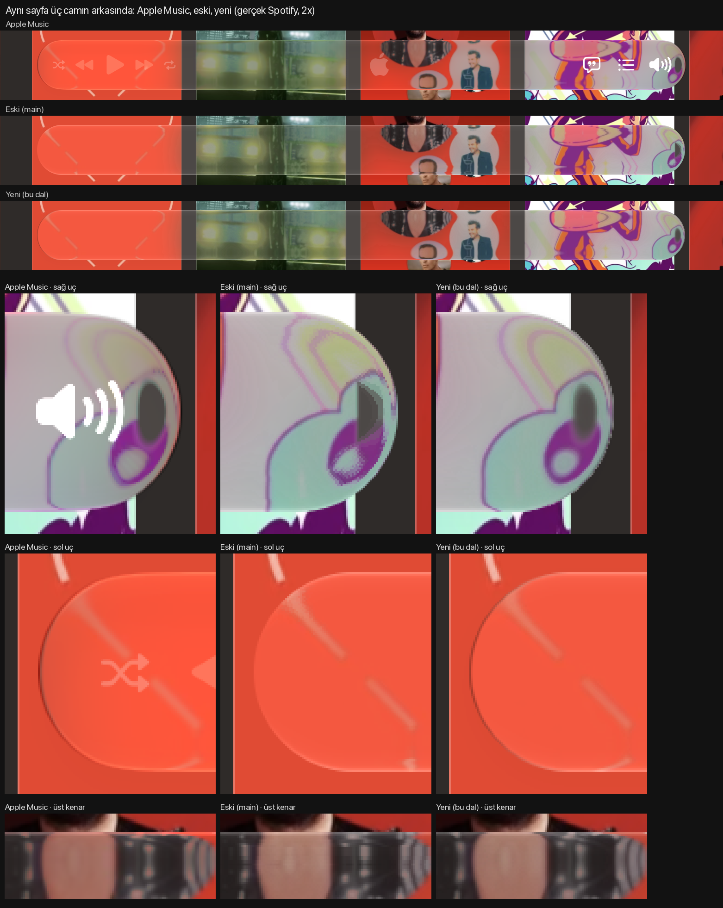

# Liquid Glass research

How macOS 26's Liquid Glass really behaves, measured against Apple's own glass, and how close an SVG
`backdrop-filter` in Chromium can get to it. Started for [mcloud](https://github.com/bulutakbulutt/mcloud), a Spicetify
theme that makes Spotify look like Apple Music, whose floating player uses the resulting filter.

**The full write-up is [research/RESEARCH.md](research/RESEARCH.md).** In short:

- Apple Music's player is SwiftUI glass (`MediaCoreUI.NowPlayingView` in a `GlassEffectContainer`); a SwiftUI
  `.glassEffect(.regular)` bar at the same geometry matches Music's own frames pixel for pixel.
- **Focus changes the glass.** In a focused window it is nearly clear (fine detail stays); in a background window it is
  diffuse. Borderless test windows cannot become key, so naive measurements get the wrong state.
- The focused glass is not a blur: a luminance tone (black 32, white 185, hue kept), a darken halo that dims bright
  detail toward darker surroundings while blacks stay, a soft mirror fold at the rim drawn at device resolution, and a
  highlight along the top and bottom edges only.
- Ground truth in motion: Apple Music can be scrolled synthetically with trackpad-style events, and its own frames
  give the content behind the player.
- Fitted SVG filter error (mean abs per channel inside the bar): 21.9 for a hand-tuned glass, 2.83 on test patterns
  and 5.97 against frames of Apple Music scrolling in the first fit; the steps below took the edges further.

## How it got here

Each step was measured against Apple's glass before it shipped in mcloud; the numbers are the difference to Apple
(mean abs per channel, lower is better). Details, dead ends and every table are in [RESEARCH.md](research/RESEARCH.md).

| Step | What changed | Result |
| --- | --- | --- |
| Start | mcloud's hand-tuned lens, white to 0.6 | 21.9 on test patterns |
| 1. Which glass, which state | Found the view Music's player uses and that **window focus changes the glass** (clear when focused, diffuse in the background); built native lab apps that capture it in the right state | Lab bar matches Music's frames to 0.3 |
| 2. First fit | Luminance tone, a darken halo, a mirror fold at the rim drawn at device resolution, top/bottom highlight | 21.9 → 2.9 on test patterns |
| 3. Ground truth in motion | Scrolled Apple Music itself and fitted to its frames and the test patterns together; highlight refit | Music frames 6.52 → 5.97, patterns 2.89 → 2.83 |
| 4. The rim, measured directly | Mapped where each rim pixel samples the page; found Chromium recomputes a shared filter result once per reader, which made every anti-aliasing pass slow | Two-layer glass (bend once, then the rest) |
| 5. Apple's lens curve | Arc lens, edge line, a blur along the edge normal where the bend magnifies | Patterns 2.29 (curve + line) → 2.15 with the normal blur; top-edge stair-steps gone |
| 6. Exact bilinear sampling | 4 fixed displacement taps blended by static weights instead of nearest-pixel lookups; thin-line darkening; Music's shadow | Rim flicker 2.7% → 2.1% (Apple 2.2%), line width 0.50pt (Apple 0.50) |
| 7. Round-end outline | Apple's dark hairline sits just **outside** the glass (fading as \|n_x\|³), and its outermost pixels mix in the page right under them | Left end over tiles 6.15 → 3.71, outer ring 24.7 → 8.8 |
| 8. Side-by-side viewer | Your own Spotify page under macOS's glass and under mcloud's, one scroll | [See it side by side](#see-it-side-by-side) |
| 9. Toolbar buttons | Recorded Music's Back / Share / More under scripted hover, press, hold and drag; found the AppKit/SwiftUI pieces (toolbar items drawn by `DesignLibrary`, `GlassInteractionFill`, FlexiGlass flags); rebuilt them for Chromium with the player's lens checked at button size, reading past the glass's edge as macOS does (`buttons/`) | Native 36pt glass = Music's Back to 0.51; lens + edge read + one-device-pixel hairline 5.6 -> 2.87; press spring 0.265 s / 0.48 (copy 0.275 / 0.42) |
| 10. Performance | The button glass at 11fps: Chromium recomputes a filter result per reader, so every extra read of the colour steps re-ran the 15px darken blur; split into three backdrop-filter layers (bend, mid, tone) | 90.6ms -> 16.7ms per frame, fit 2.45 -> 2.48 |



*The same page behind Apple Music's player (top), mcloud `main` and the research branch (step 6); below, both round
ends and the top edge enlarged. Labels are Turkish: "Eski" = old, "Yeni" = new, "sağ/sol uç" = right/left end.*

The left-end halo and hairline of step 7 are in [left-end-halo.png](research/compare/left-end-halo.png) and
[left-end-hairline.png](research/compare/left-end-hairline.png). Steps 5–7 are on mcloud's
[`claude/liquid-glass-research-e10174`](https://github.com/bulutakbulutt/mcloud/tree/claude/liquid-glass-research-e10174)
branch, not yet in its `main`.

**Still open:** Apple's glass reads the page up to ~12pt beside its edge into its rim (measured in step 9, the same on
the player; the button copy reads it through a larger filter box, mcloud's player does not yet); thin bright lines are still a little brighter than Apple's; light pages are less covered by the fit than dark ones.

## See it side by side

On a Mac with macOS 26 or later, Google Chrome, Spotify and the Xcode command line tools (`xcode-select --install`):

```sh
curl -fsSL https://raw.githubusercontent.com/emribilemir/liquid-glass-research/main/side-by-side/install.sh | bash
```

It copies your Spotify home page (Spotify restarts twice and scrolls by itself for a few seconds), then opens two
windows over that copy: on the left macOS's own Liquid Glass bar (SwiftUI `.glassEffect`, the glass Apple Music's
player uses), on the right [mcloud](https://github.com/bulutakbulutt/mcloud)'s bar in Chrome. Scroll either window
and both follow. A third window, **Zoom**, shows the same spot of both side by side, magnified with no smoothing,
following the pointer over either window (`+` / `-` magnify, `F` freezes the spot, `0` resets); it needs the Screen
Recording permission for the terminal that runs it, and never takes focus (macOS glass changes its look in a window
that is not key). To compare a branch that is not in mcloud's `main` yet, such as the player on the new lens, pass
`--ref claude/apple-music-button-behavior-a5154f`. Run the same command again to reopen it; add options after `bash -s --`: `--resnap` copies the page
again, `--ref <branch>` compares another mcloud branch, `--theme <dir>` a local mcloud checkout. Everything lives in
`~/Library/Application Support/LiquidGlassSideBySide`; delete that folder to remove it.

## Layout

| Path | What |
| --- | --- |
| `research/RESEARCH.md` | Findings, method, results, dead ends, open questions |
| `side-by-side/` | The side-by-side viewer (`install.sh`, `SideBySide.swift`) |
| `buttons/` | Chromium copy of Music's toolbar glass buttons (`glass-buttons.js`/`.css`, demo `index.html`, `verify.mjs`) |
| `research/fit/` | Fit backgrounds (`bg/`) and native captures (`apple/` focused, `apple-unfocused/`) |
| `research/music-scroll/` | Barless content and reference frames from Apple Music scrolling |
| `research/scenes/`, `research/grid/` | Real scenes behind Music's player, grid/edge probes |
| `research/compare/` | Side-by-side images and videos (native vs SVG) |
| `research/params/` | Fitted parameter sets and fit logs |
| `research/*.py` | Analysis scripts (PNG decoding, scoring, edge and line probes) |
| `tools/` | Native lab apps (Swift), capture scripts, Chromium fit harness, motion tests; see [tools/README.md](tools/README.md) |

`research/local/` (frame sequences, ~130MB) is not in git; the tools regenerate it.

Measured on macOS 27.0.1, MacBook built-in Retina display (2x, P3), System Settings › Appearance › Liquid Glass at the
leftmost setting. Album artwork and Apple Music screenshots in `research/` are third-party content, included only as
measurement data.
